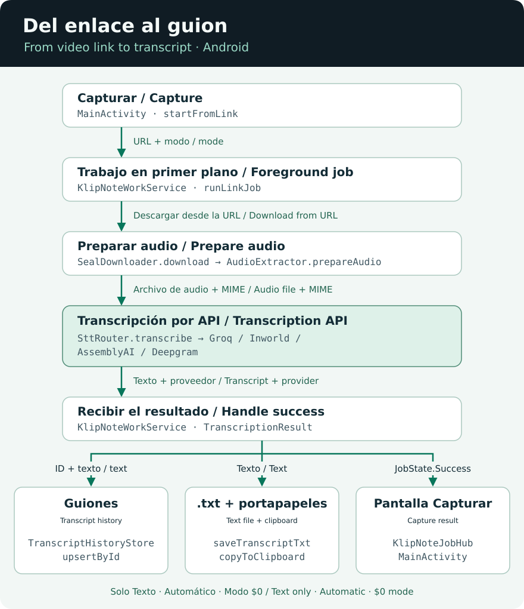

# KlipNote

[English](README.md) · Español


KlipNote convierte la voz de un video o un audio en texto. Pega un enlace, comparte contenido desde otra app o elige un archivo del teléfono. KlipNote prepara el audio, lo envía al servicio de transcripción con tu propia llave y guarda el guion para buscarlo, copiarlo o enviarlo a una app de IA.

[Descargar el APK para Android](https://github.com/gabrieldave/KlipNote/releases/latest) · [Conseguir una llave](docs/llaves-gratis.md) · [Preguntas frecuentes](docs/preguntas-frecuentes.md) · [GPL-3.0](LICENSE)

## Prueba con un video

1. En la página de la versión, abre **Assets** y descarga el archivo `.apk`. Instálalo en un teléfono Android 8.0 o posterior con procesador **arm64**. Si Android lo solicita, permite la instalación desde la app con la cual abriste el APK.
2. Sigue el asistente para registrar una llave, o entra en **Ajustes → Mis llaves**. Basta un servicio configurado con crédito disponible.
3. En **Capturar**, pega el enlace a un video público con voz clara. Elige **Solo texto** y pulsa **Extraer Guion**.
4. Lee el resultado en Capturar. Entra en **Guiones** y busca una frase de la grabación. La app también copia el texto al portapapeles e intenta guardar un archivo UTF-8 en `Descargas/KlipNote/Texto/`.
5. Pulsa **Enviar con IA** para compartir el archivo junto con instrucciones para un brief, una infografía, una página HTML y una presentación. Elige la app de destino en el selector de Android. Esa app genera los cuatro resultados.

**Al actualizar**, instala el nuevo APK sobre la versión anterior si conservan la misma firma. El paso de v1.7.2 o anterior a v1.7.3 o posterior requiere desinstalar una vez por el cambio de certificado. La desinstalación borra los datos locales. Conserva antes los guiones y llaves que necesites.

<p align="center">
  
  
  
  
</p>

## Funciones

| Tarea | Opciones |
| --- | --- |
| Capturar voz | Pega enlaces de YouTube, TikTok, Instagram, Facebook o X. Comparte audio o video desde Galería o WhatsApp, o elige un archivo local. Algunos videos requieren iniciar sesión en el sitio. |
| Elegir el resultado | Solo texto, audio y texto, video y texto, o solo descarga. Elige detección automática del idioma de voz o fija uno. |
| Trabajar con un guion | Busca en el historial, copia texto, guarda o comparte el `.txt`, o envíalo a otra app con instrucciones de estudio y presentación. |
| Administrar la app | Configura servicios, consulta sus medidores de consumo, cambia el tema, respalda los guiones o exporta las llaves por separado con cifrado. |

**Costo y privacidad.** La app es gratuita. El modo Automático prueba los proveedores configurados según su prioridad. El orden inicial es Groq, Inworld, AssemblyAI y Deepgram. El **Modo $0** bloquea el motor de pago al final de la lista. Si registras una tarjeta con un proveedor, sus condiciones determinan los cargos al terminar el crédito. Las llaves se cifran en el teléfono. El audio viaja al proveedor elegido para su transcripción. KlipNote carece de servidor propio de transcripción y de analítica de uso. GitHub distribuye actualizaciones opcionales de ofertas, información sobre versiones del APK y actualizaciones del motor de descargas. [Guía de proveedores](docs/llaves-gratis.md) · [Configuración de ofertas](config/stt-router.json)

## Arquitectura · Del enlace al guion

KlipNote es una app Android en Kotlin. Jetpack Compose y Material 3 dibujan la interfaz. Las corrutinas ejecutan el trabajo en segundo plano y OkHttp comunica la app con los proveedores. El manifiesto registra la pantalla inicial, la recepción de contenido compartido y el servicio en primer plano. Al arrancar, la app recupera el idioma, carga la configuración de proveedores guardada e inicia el motor de descargas. [Configuración de compilación](app/build.gradle.kts) · [Manifiesto](app/src/main/AndroidManifest.xml) · [KlipNoteApplication.kt](app/src/main/java/com/blackeye/klipnote/KlipNoteApplication.kt)



| Etapa | Archivos, funciones y datos |
| --- | --- |
| Recibir el enlace | En [MainActivity.kt](app/src/main/java/com/blackeye/klipnote/MainActivity.kt), `startFromLink` extrae la URL y comprueba el trabajo activo, la llave y la disponibilidad del motor. `launchLinkJob` pasa al servicio la URL, el modo, el idioma y la selección de proveedor. |
| Preparar el audio | En [KlipNoteWorkService.kt](app/src/main/java/com/blackeye/klipnote/KlipNoteWorkService.kt), `runLinkJob` llama a `download` de [SealDownloader.kt](app/src/main/java/com/blackeye/klipnote/SealDownloader.kt) (yt-dlp) y a `prepareAudio` de [AudioExtractor.kt](app/src/main/java/com/blackeye/klipnote/AudioExtractor.kt). El modo de descarga termina antes de la transcripción. |
| Transcribir | En [SttRouter.kt](app/src/main/java/com/blackeye/klipnote/SttRouter.kt), `transcribe` recibe el archivo de audio y su tipo MIME. En modo automático, `transcribeCascade` omite proveedores sin disponibilidad e intenta el siguiente si falla una petición. La respuesta incluye texto, proveedor y duración cuando está disponible. |
| Guardar y mostrar | El servicio llama a `upsertById` en [TranscriptHistoryStore.kt](app/src/main/java/com/blackeye/klipnote/TranscriptHistoryStore.kt) con el ID de la entrada, la URL original y el guion. Llama a `saveTranscriptTxt`, copia el texto y publica el resultado mediante [KlipNoteJobHub.kt](app/src/main/java/com/blackeye/klipnote/KlipNoteJobHub.kt). Capturar recibe el nuevo estado y actualiza el historial. |

**Decisiones de diseño.** El servicio guarda el guion aunque la pantalla Capturar esté cerrada. La interfaz reutiliza el ID del historial para evitar duplicados al regresar. Los archivos locales entran por `runTranscription` en `MainActivity` y comparten la preparación de audio y el enrutador. Esa es la entrada para investigar un fallo de importación. El orden configurable permite ajustar proveedores al cambiar sus ofertas. El permiso del motor de pago reside en el dispositivo. [RemoteRouterConfig.kt](app/src/main/java/com/blackeye/klipnote/RemoteRouterConfig.kt) · [BillingManager.kt](app/src/main/java/com/blackeye/klipnote/BillingManager.kt)

## Por dónde empezar un cambio

Lee [AGENTS.md](AGENTS.md) antes de editar.

| Quiero cambiar | Empieza en | Cómo comprobarlo |
| --- | --- | --- |
| Controles de captura o resultado | [MainActivity.kt](app/src/main/java/com/blackeye/klipnote/MainActivity.kt) (`CapturarTab`, `TranscriptActionBar`) | Extrae un enlace corto y abre el mismo guion en el historial. Comprueba los textos y acciones en ambas pantallas. |
| Prioridad o disponibilidad de proveedores | [Configuración de ofertas](config/stt-router.json), [RemoteRouterConfig.kt](app/src/main/java/com/blackeye/klipnote/RemoteRouterConfig.kt), [SttRouter.kt](app/src/main/java/com/blackeye/klipnote/SttRouter.kt) | Ejecuta [RemoteRouterConfigTest](app/src/test/java/com/blackeye/klipnote/RemoteRouterConfigTest.kt) para el orden inicial. Prueba un orden personalizado en un teléfono con proveedores configurados y Modo $0 activo. |
| Paquete de cuatro entregables para IA | [AiStudyPrompts.kt](app/src/main/java/com/blackeye/klipnote/AiStudyPrompts.kt), [SavedMedia.kt](app/src/main/java/com/blackeye/klipnote/SavedMedia.kt) | Ejecuta [AiStudyPromptsTest](app/src/test/java/com/blackeye/klipnote/AiStudyPromptsTest.kt). Pulsa **Enviar con IA** y comprueba la recepción del archivo y las instrucciones en la app de destino. |

### Compilación y comprobaciones

El proyecto emplea JDK 17, Android SDK Platform 35 y Build Tools 35.0.0 en las [comprobaciones de pull requests](.github/workflows/pr-checks.yml). Si hace falta, configura la ruta local del SDK. [Ejemplo de configuración](local.properties.example)

```sh
./gradlew testDebugUnitTest assembleDebug
adb devices
adb -d install -r app/build/outputs/apk/debug/*.apk
```

El comando de instalación selecciona un teléfono conectado por USB. La app de depuración tiene el identificador `com.blackeye.klipnote.debug`. Para esta entrega se renderizaron ambas imágenes, se comprobaron los enlaces locales de los README y se siguió el recorrido en el código. El intento local de Gradle se detuvo antes de ejecutar las tareas porque el wrapper no logró descargar Gradle 8.9. La instalación y la transcripción en un teléfono quedan pendientes de verificación local.

## Proyecto y créditos

Mantenimiento a cargo de [@gabrieldave](https://github.com/gabrieldave). Consulta el [historial de versiones](CHANGELOG.md), el [índice de guías](docs/README.es.md) y la [guía para contribuir ofertas](docs/contribuir-ofertas.md). Se reciben reportes de fallos y propuestas mediante pull requests. Los cambios a los workflows requieren revisión del mantenedor.

Licencia [GNU GPL v3.0](LICENSE). [yt-dlp](https://github.com/yt-dlp/yt-dlp) gestiona las descargas a través de [youtubedl-android](https://github.com/yausername/youtubedl-android) y su fork de junkfood02. [Seal](https://github.com/JunkFood02/Seal) aportó ideas y componentes de descarga. Consulta los [avisos de terceros](THIRD_PARTY_NOTICES.md) y los [textos de licencias](LICENSES/). Respeta los términos de las plataformas y los derechos del contenido. KlipNote es independiente de los servicios y marcas mencionados.
