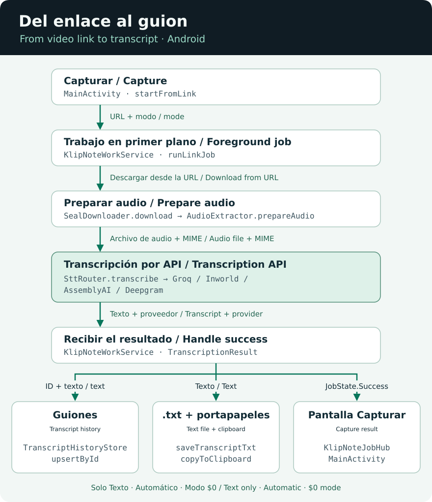

# KlipNote

English · [Español](README.es.md)


Turn spoken words in videos and audio files into searchable transcripts on Android. Paste a link, share media from another app, or pick a file on your phone. KlipNote prepares the audio, sends it to a transcription service with your own API key, and keeps the text available to copy, save, or send to an AI app.

[Download the Android APK](https://github.com/gabrieldave/KlipNote/releases/latest) · [Get a provider key](docs/free-keys.md) · [FAQ](docs/faq.md) · [GPL-3.0](LICENSE)

## Try it with one video

1. On the release page, open **Assets** and download the `.apk`. Install it on an Android 8.0+ phone with an **arm64** processor. If Android asks, allow the app that opened the APK to install it.
2. Follow onboarding to add a provider key, or open **Settings → My keys**. One configured provider with available credit is enough to start.
3. In **Capture**, paste a public video link with clear speech. Select **Text only** and tap **Extract transcript**.
4. Read the result in Capture. Open **Transcripts** and search for a phrase from the recording. The app also copies the result and attempts to export a UTF-8 file to `Download/KlipNote/Texto/`.
5. Tap **Send with AI** to share the text file and instructions for a brief, infographic, HTML page and slide deck. Choose the receiving app in Android. That app generates the requested outputs.

**Upgrading:** install newer releases over an existing installation with the same signature. Moving from v1.7.2 or earlier to v1.7.3+ requires a one-time uninstall because the signing certificate changed. Uninstalling clears local data. Preserve any text and keys you need first.

<p align="center">
  
  
  
  
</p>

## What you can do

| Task | Options |
| --- | --- |
| Capture speech | Paste links from YouTube, TikTok, Instagram, Facebook or X. Share audio or video from Gallery or WhatsApp, or choose a local file. Some videos require a site login. |
| Choose the output | Text only, audio + text, video + text, or download only. Select automatic speech-language detection or a fixed language. |
| Reuse a transcript | Search history, copy text, save or share a `.txt`, or send it to another app with study and presentation instructions. |
| Manage the app | Configure individual providers, inspect usage meters, change color themes, back up transcripts, or export an encrypted key backup separately. |

**Cost and privacy.** The app is free. Automatic routing tries configured providers in priority order. The default order is Groq, Inworld, AssemblyAI, then Deepgram. **$0 mode** blocks the final paid engine. A provider with your payment details can bill under its own terms when its allowance runs out. Keys are encrypted on the phone, and audio goes directly to the selected provider for transcription. KlipNote has no first-party transcription server or usage analytics. GitHub supplies optional offer updates, APK release information and downloader updates. [Provider guide](docs/free-keys.md) · [Offer configuration](config/stt-router.json)

## Architecture · From a video link to text

KlipNote is a Kotlin Android app with a Jetpack Compose / Material 3 interface, coroutines for background work and OkHttp for provider requests. The manifest registers the launcher, Android share targets and a foreground data-sync service. At startup the application restores language and cached routing settings and initializes the downloader. [Build configuration](app/build.gradle.kts) · [Manifest](app/src/main/AndroidManifest.xml) · [KlipNoteApplication.kt](app/src/main/java/com/blackeye/klipnote/KlipNoteApplication.kt)



| Follow the action | Code and data |
| --- | --- |
| Capture the link | [MainActivity.kt](app/src/main/java/com/blackeye/klipnote/MainActivity.kt): `startFromLink` extracts the URL and checks for an active job, a key and downloader readiness. `launchLinkJob` passes the URL, output mode, language and routing selection to the service. |
| Prepare the audio | [KlipNoteWorkService.kt](app/src/main/java/com/blackeye/klipnote/KlipNoteWorkService.kt): `runLinkJob` calls `download` in [SealDownloader.kt](app/src/main/java/com/blackeye/klipnote/SealDownloader.kt) (yt-dlp), then `prepareAudio` in [AudioExtractor.kt](app/src/main/java/com/blackeye/klipnote/AudioExtractor.kt). Download-only jobs finish before transcription. |
| Transcribe | [SttRouter.kt](app/src/main/java/com/blackeye/klipnote/SttRouter.kt): `transcribe` takes the audio file and MIME type. In automatic mode, `transcribeCascade` skips ineligible providers and tries the next eligible one after a failure. The successful response includes text, provider and duration when available. |
| Save and display | The service calls `upsertById` in [TranscriptHistoryStore.kt](app/src/main/java/com/blackeye/klipnote/TranscriptHistoryStore.kt) with the job ID, original URL and transcript. It calls `saveTranscriptTxt`, copies the text, and publishes success through [KlipNoteJobHub.kt](app/src/main/java/com/blackeye/klipnote/KlipNoteJobHub.kt). Capture observes the state and refreshes history. |

**Design decisions.** The service persists a successful link job even when Capture is closed. The UI reuses the same history ID so reopening the screen does not duplicate the entry. Local files enter through `runTranscription` in `MainActivity` and share the audio preparation and router. Use the local-file path when diagnosing an import issue. Configurable provider order lets the app adapt to changing offers. The paid-engine permission stays on the device. [RemoteRouterConfig.kt](app/src/main/java/com/blackeye/klipnote/RemoteRouterConfig.kt) · [BillingManager.kt](app/src/main/java/com/blackeye/klipnote/BillingManager.kt)

## Where to make a change

Read [AGENTS.md](AGENTS.md) before editing.

| I want to change | Start in | How to check |
| --- | --- | --- |
| Capture or result controls | [MainActivity.kt](app/src/main/java/com/blackeye/klipnote/MainActivity.kt) (`CapturarTab`, `TranscriptActionBar`) | Extract a short link, then open the same entry in Transcripts. Check labels and available actions on both screens. |
| Provider priority or eligibility | [Offer configuration](config/stt-router.json), [RemoteRouterConfig.kt](app/src/main/java/com/blackeye/klipnote/RemoteRouterConfig.kt), [SttRouter.kt](app/src/main/java/com/blackeye/klipnote/SttRouter.kt) | Run [RemoteRouterConfigTest](app/src/test/java/com/blackeye/klipnote/RemoteRouterConfigTest.kt) for the default order. Check custom routing on a device with configured providers and $0 mode enabled. |
| The four-in-one AI handoff | [AiStudyPrompts.kt](app/src/main/java/com/blackeye/klipnote/AiStudyPrompts.kt), [SavedMedia.kt](app/src/main/java/com/blackeye/klipnote/SavedMedia.kt) | Run [AiStudyPromptsTest](app/src/test/java/com/blackeye/klipnote/AiStudyPromptsTest.kt). Tap **Send with AI** and check receipt of both the file and instructions in the destination app. |

### Build and verification

Use JDK 17, Android SDK Platform 35 and Build Tools 35.0.0, as in [PR checks](.github/workflows/pr-checks.yml). Set the SDK path locally if needed. [Example SDK settings](local.properties.example)

```sh
./gradlew testDebugUnitTest assembleDebug
adb devices
adb -d install -r app/build/outputs/apk/debug/*.apk
```

The install command selects a USB-connected phone. Debug builds use `com.blackeye.klipnote.debug`. For this documentation update, both images were rendered, the local README links were checked, and the source path above was traced. The local Gradle attempt stopped before the tasks ran because the wrapper could not download Gradle 8.9. APK installation and live transcription were not tested locally.

## Project and credits

Maintained by [@gabrieldave](https://github.com/gabrieldave). See the [changelog](CHANGELOG.md), [guide index](docs/README.md) and [offer contribution guide](docs/contributing-offers.md). Issues and pull requests are welcome. Workflow changes require maintainer review.

Licensed under [GNU GPL v3.0](LICENSE). [yt-dlp](https://github.com/yt-dlp/yt-dlp) powers downloads through [youtubedl-android](https://github.com/yausername/youtubedl-android) and its junkfood02 fork. [Seal](https://github.com/JunkFood02/Seal) provided download ideas and components. See [third-party notices](THIRD_PARTY_NOTICES.md) and [license texts](LICENSES/). Respect platform terms and the rights of content owners. KlipNote is independent of the platforms and providers mentioned here.
